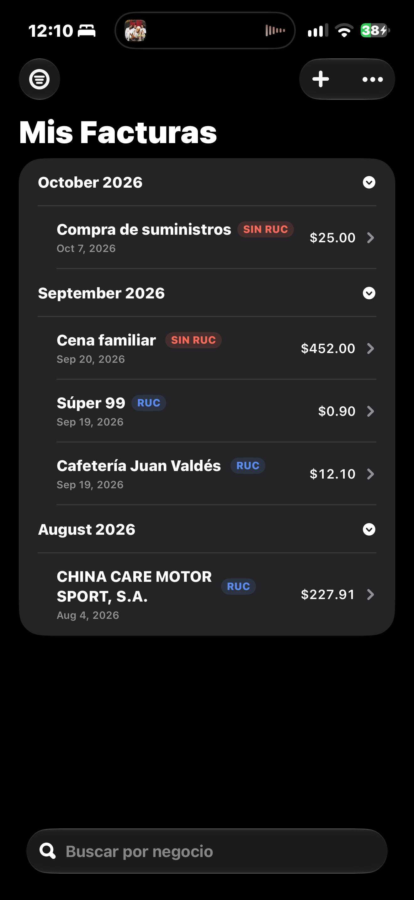
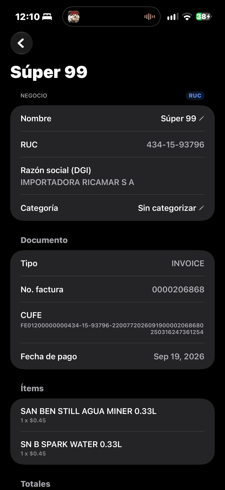
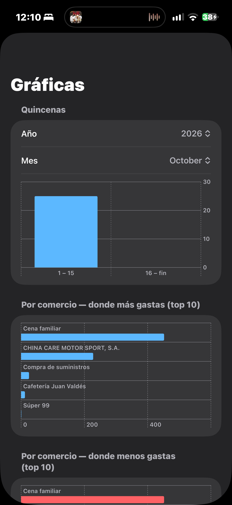
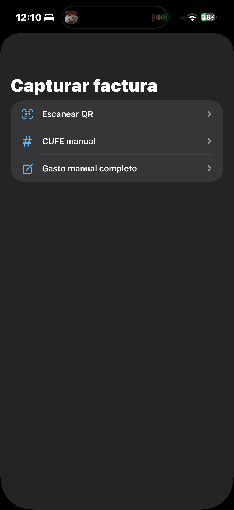

# Cuentas Claras

[](https://github.com/JustinoLM/cuentas-claras/actions/workflows/tests.yml)


**A local-first iOS app that turns Panama's electronic invoices into a personal expense history.**
Scan the QR code on a DGI e-invoice and the app fetches the official invoice record, parses every line item and stores it on your phone. No account, no server, no AI.

<!-- TODO: add 3–4 screenshots to docs/images/ and update the paths below -->
<p align="center">
  
  
  
  
</p>

## Why

Electronic invoices in Panama include a QR code that points to the invoice's official record at the DGI. That record already holds everything an expense tracker needs: merchant, RUC, line items, ITBMS and totals. In practice it ends up as a paper receipt or a PDF in an inbox. Cuentas Claras reads the QR and turns the invoice into structured data you can browse, categorize and chart, without typing it in by hand.

## Status

**v1.0.0: code complete** (Phases 1–5). This is a personal project, built for my own use and as a portfolio piece; it is not distributed on the App Store. Next up: recurring payments and savings/investment tracking (Phase 6).

## Features

- **Three capture paths:** live QR scan (also from PDF invoices), manual CUFE entry, or a fully manual expense for places that don't issue e-invoices.
- **Review before saving:** nothing is stored until you confirm it.
- **Duplicate protection:** hard block by CUFE, plus a soft warning for manual expenses that look like an existing one.
- **Offline queue:** lookups that fail for network reasons are kept and retried when the app returns to the foreground.
- **Merchant-based categorization:** categorize a merchant (by RUC) once and all of its invoices inherit the category. Aliases cover cases where the registered legal name doesn't match the store name you know.
- **Charts (Swift Charts):** spending by *quincena* (pay period), category, month, year, top merchants and visit frequency.
- **Search and filters:** with/without RUC, date range, category, payment method.
- **Face ID / Touch ID lock.**
- **Optional data export, all CSV:**
  - Automatic full backup in the Files app, no setup required.
  - Manual append-only export to a file you choose.
  - Optional OneDrive sync, one file per expense, ready to combine in Excel, Power Query or Power BI.

## How it works

```
QR scan / PDF / manual CUFE
        ↓
Extract CUFE → validate locally with the DGI's own regex (no network call if invalid)
        ↓
GET DGI public lookup endpoint → parse server-rendered HTML (SwiftSoup)
        ↓
Review screen → save to SwiftData  ← single source of truth
        ↓
In-app charts · local CSV backup · manual export · OneDrive sync (each optional and independent)
```

## Design decisions

Every decision is documented with its rationale in the [technical spec](docs/spec-invoice-scanner.md). The main ones:

- **Local-first, no backend.** The core app works with zero external accounts. Because no user data is centralized, the developer never becomes the data controller under Panama's Law 81 (personal data protection).
- **Only the CUFE is taken from the QR.** The QR URL also carries a `jwt` and a `digestValue`. Testing showed the short CUFE endpoint returns the exact same invoice HTML, so those parameters are discarded.
- **No OCR, no photos.** QR size doesn't grow with receipt length, the manual paths cover every case where the QR fails, and there are no images to protect.
- **Validate before touching the network.** The CUFE is checked against the regex the DGI itself exposes in its web form, so malformed codes never trigger a request.
- **Parse by `data-title`, not by column header.** The DGI item table header says "ITBMS" while the cell attribute says "Impuesto". Mapping by header produces a silent `nil` in the tax field. Parser tests against captured DGI responses catch markup changes.
- **UUID primary keys, not CUFE**, since manual expenses don't have one.
- **Export-friendly CSV:** one denormalized row per line item, UTF-8 with BOM, ISO 8601 dates, locale-independent number formatting and a versioned schema, so Excel and Power BI read it correctly under any regional settings.
- **Minimal OneDrive permissions:** `Files.ReadWrite.AppFolder` scope, MSAL with PKCE (no client secret in the binary) and tokens kept in the Keychain, device-only.
- **No background timers.** iOS background scheduling is unreliable, so retries and sync run when the app comes to the foreground, with a guard against overlapping cycles.
- **Certificate pinning intentionally skipped** for v1: the risk of breaking the app on a certificate rotation outweighs the threat level for a personal expense tracker.

## Known limitations

- The DGI lookup endpoint is public but undocumented and could change without notice. The parser test suite exists to detect that early.
- Credit notes are recognized but not processed in v1 (marked as unsupported).
- Microsoft's `Files.ReadWrite.AppFolder` scope is in preview and only works with personal Microsoft accounts.
- iOS only.

## Tech stack

| Area | Technology |
|---|---|
| UI | SwiftUI, Swift Charts (Apple HIG, no third-party UI libraries) |
| Persistence | SwiftData |
| Scanning | VisionKit `DataScannerViewController`; Vision + PDFKit for PDF invoices |
| Parsing | URLSession + SwiftSoup |
| Cloud (optional) | MSAL + Microsoft Graph (OneDrive app folder) |
| Security | Keychain, LocalAuthentication, App Transport Security |
| CI | GitHub Actions |

## Testing

The parser is tested against four real DGI HTML responses captured during design: a valid invoice, a non-existent CUFE, a malformed CUFE, and the full QR URL response. Additional tests target the riskiest logic (deduplication and analytics) rather than chasing coverage. CI runs on every pull request and skips docs-only changes.

## Development process

I designed the app and wrote the full [technical spec](docs/spec-invoice-scanner.md) before writing any code. Implementation was done phase by phase with Claude Code, following that spec and the project conventions in [`CLAUDE.md`](CLAUDE.md). Work follows GitHub Flow (issue → branch → PR → merge) with Conventional Commits and a version tag per phase (`v0.1.0` … `v1.0.0`). Details in [`docs/git-workflow.md`](docs/git-workflow.md).

## Requirements

- Xcode 27+ (required by the project's pbxproj format; CI uses the `xcode-27` runner image for the same reason)
- iOS 18+ deployment target (the real minimum is iOS 17 for SwiftData; 18 leaves a margin)
- A physical iPhone to test the QR scanner. The Simulator doesn't support live camera capture.

## Setup

1. Clone the repo and open `Cuentas Claras/Cuentas Claras.xcodeproj`.
2. Select your own Apple ID as the signing team (Signing & Capabilities) to run on a device.
3. Build and run.

**Note:** MSAL is pinned to exactly 2.16.0 because the 2.16.1 release was published without its binary. Return to "Up to Next Major" once a release ships with it.

## Roadmap

- [x] Phase 1: Core (SwiftData models, DGI parser, capture paths, deduplication, offline queue, categorization, charts) — `v0.1.0`
- [x] Phase 2: Local CSV backup and manual export with schema versioning — `v0.2.0`
- [x] Phase 3: OneDrive sync and backup — `v0.3.0`
- [x] Phase 4: Face ID lock, Privacy Manifest, ATS verification — `v0.4.0`
- [x] Phase 5: Filters, message polish, risk-focused tests — `v1.0.0`
- [ ] Phase 6: CSV format update, recurring payments, savings and investments
- [ ] Full credit note support (pending a real sample)

## License

<!-- TODO: choose a license (e.g. MIT) or state "All rights reserved" -->
TBD

## Author

**Justin Williams** — Software Engineering student, Universidad Tecnológica de Panamá
[LinkedIn](https://www.linkedin.com/in/jugawike)
